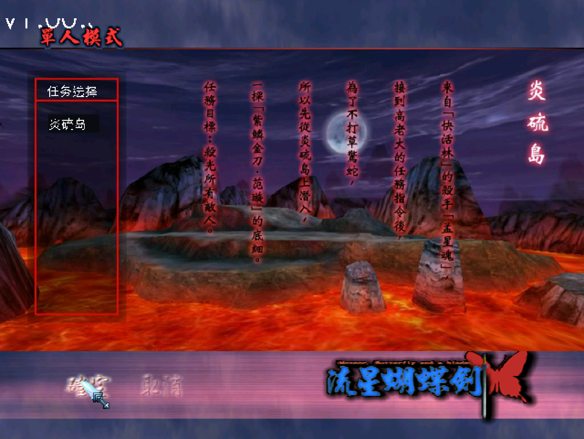
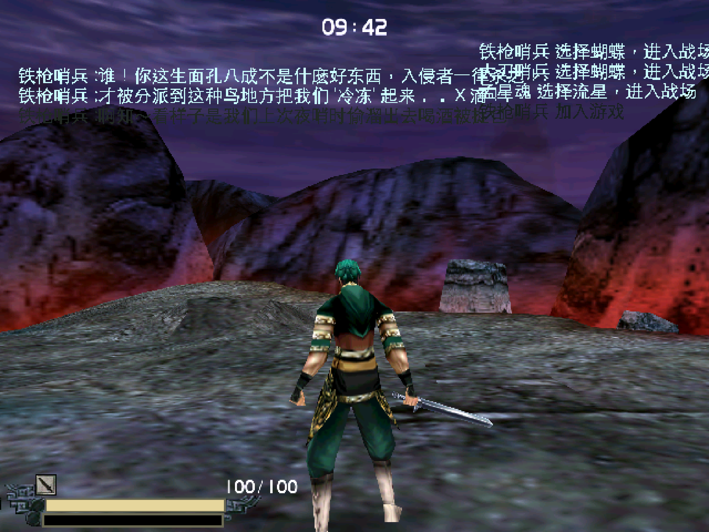

# 流星蝴蝶剑 Mac 版

在 Apple Silicon Mac 上直接运行 2002 年原版《流星蝴蝶剑》的 `Meteor.exe`。不用 Wine、虚拟机，也不是社区重制版。磁盘上的 EXE 一字节不改。




这个仓库给三类人：

| 你想 | 看哪里 |
|---|---|
| 下载直接玩 | 下面的「下载与运行」 |
| 看源码、自己构建 | [runtime/](runtime/) 和「从源码构建」 |
| 用 AI 把别的老 Windows 程序移植到 Mac | [移植 Skill](skills/win-to-mac-port/SKILL.md) |

## 怎么做到的

1. 用 [REA](https://github.com/morluto/rea) 逆向原版 EXE：它导入了哪些 Windows 接口、关卡进度存在哪、声音怎么播。
2. AI 按逆向结果写出这些接口的 Mac 实现：DirectDraw/Direct3D 6 → OpenGL，DirectSound/DirectShow → CoreAudio，Win32 窗口和输入 → AppKit，Winsock → BSD socket。
3. M 系列芯片不能直接跑 x86 指令，原版指令由 CPU 模拟器 [Unicorn](https://www.unicorn-engine.org/) 转译执行（原理类似 Rosetta，只管 CPU 指令，不含 Windows 系统）。热路径用 C 写，关卡内稳定 60fps。

整个运行时约 2400 行（Python + C + Objective-C）。

## 下载与运行

1. 在 [Releases](../../releases) 下载 `MeteorMac-arm64.zip`，解压得到 `流星蝴蝶剑.app`，拖进「应用程序」。
2. 首次打开：右键 → 打开（应用没有 Apple 公证）。仍被拦截时在终端运行：

   ```bash
   xattr -dr com.apple.quarantine /Applications/流星蝴蝶剑.app
   ```

3. 按提示选择你自己的游戏目录，二选一：
   - 装好的游戏目录（含 `Meteor.exe`），比如从 Windows 拷来的 `C:\Meteor`。
   - 原版安装盘目录（含 `data1.cab`）。需要先 `brew install unshield`，程序会自动解包。
4. Release 包已预置 CD Key，不用输入。

本仓库和 Release 都不含游戏文件。首次启动会解锁单人模式全部 9 关。

## 操作

| 操作 | 按键 |
|---|---|
| 移动 | W / S / A / D |
| 转向、视角 | 方向键、鼠标，或触摸板双指滑动 |
| 攻击 | 鼠标左键 / 触摸板单击 / J |
| 防御 | 鼠标右键 / 触摸板双指单击 / K |
| 跳 | 空格 |
| 菜单、离开战局 | Esc（关卡内确认后回主菜单） |
| 锁定 / 释放鼠标 | 点击画面 / 按 ⌘ |
| 退出 / 隐藏 / 最小化 / 全屏 | ⌘Q / ⌘H / ⌘M / ⌃⌘F，或窗口左上角按钮 |

支持有线、蓝牙鼠标和触摸板。窗口可拉伸、可全屏，画面保持 4:3，3D 按 Retina 实际像素渲染。

## 已验证

主菜单 → 单人模式 → 第一关炎硫岛、最后一关炼铁狱 → 移动、战斗、掉血 → 背景音乐和音效 → Esc 回主菜单 → 退出游戏。

已知限制：
- 仅 Apple Silicon，macOS 12 以上。
- 片头 `.mv` 视频跳过。
- 进关卡约 9 秒：加载时大量 x86 计算要经 Unicorn 转译成 ARM 执行；进关卡后渲染走原生 OpenGL，60fps。
- 联机只做了单机需要的本地 UDP。

## 从源码构建

需要 Xcode 命令行工具和 [uv](https://docs.astral.sh/uv/)：

```bash
uv python install 3.12
cd runtime && ./build.sh
```

产物在 `runtime/dist/`：`流星蝴蝶剑.app` 和 `MeteorMac-arm64.zip`。App 自带 Python，别人的 Mac 上不用装任何东西。`SERIAL=<文件> ./build.sh` 可预置 CD Key。

调试用的环境变量：

| 变量 | 作用 |
|---|---|
| `METEOR_GAME` | 游戏目录 |
| `METEOR_DATA` | 数据目录（默认 `~/Library/Application Support/MeteorMac`） |
| `METEOR_SCRIPT` | 脚本化输入回放，格式见 [host.py](runtime/host.py) |
| `METEOR_SNAP` | 每 N 秒截一张画面到 `logs/` |
| `METEOR_TRACE` | 逗号分隔的 guest 地址，执行到时打印栈参数 |

## 源码结构

| 文件 | 作用 |
|---|---|
| `runner.py` | Unicorn 模拟入口、导入表桩、回调队列 |
| `paths.py` | 游戏目录、数据目录、首次设置 |
| `win32.py` `window.py` `heap.py` `registry.py` `file_search.py` | Win32 接口 |
| `com.py` | COM 对象和虚表 |
| `ddraw.py` `d3d.py` `d3dgl.c` `fast.c` `gdi.py` `opengl.py` `opengl_noop.py` `pixels.c` | 图形 |
| `dsound.py` `dshow.py` `audio.c` | 声音 |
| `winsock.py` | 网络 |
| `host.m` `host.py` `input.py` | Mac 窗口、键鼠、DirectInput |
| `launcher.c` `build.sh` `make_icon.py` | .app 启动器、打包、图标 |

## 许可

本仓库代码使用 MIT 许可。《流星蝴蝶剑》的游戏文件、美术和商标归原权利人所有，请使用你自己拥有的游戏副本。
